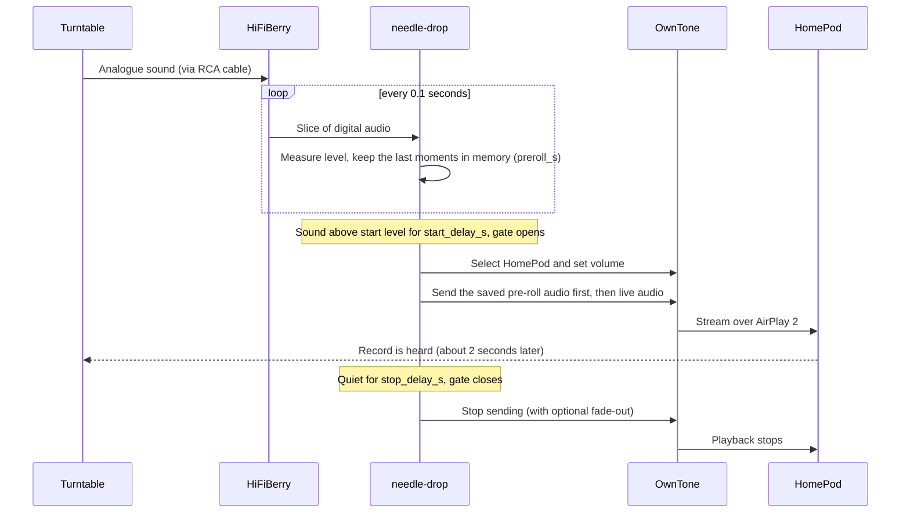
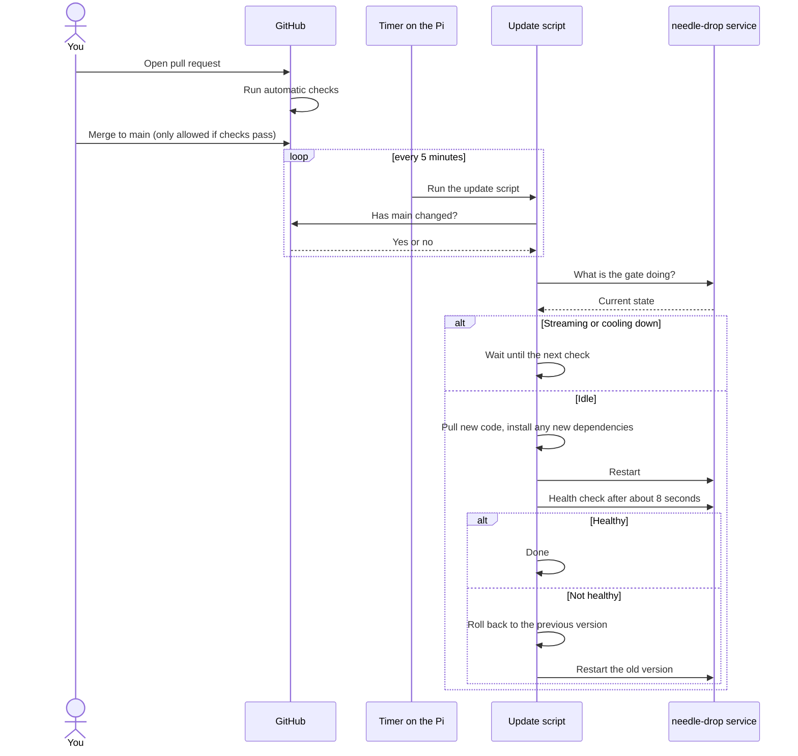

# needle-drop

Drop the needle, hear the record. **needle-drop** listens to your record player and automatically streams it to an AirPlay 2 speaker (built and tested around an original HomePod) with no taps, no phone and no switches. When the record ends, or the player is switched off, it stops.

The crackle is kept. The sound is passed along untouched, with no clean-up, noise reduction or filtering.

## Features

- **Hands-free:** needle down means sound, and it stops by itself after the record finishes.
- **Doesn't start when the player is off:** a "gate" decides when a record is really playing, ignoring hum and bumps.
- **Loses no audio:** a short pre-roll buffer means the needle landing and the first notes aren't missed. The HomePod plays a couple of seconds behind, which is normal for AirPlay.
- **Untouched sound:** nothing is added to or removed from the audio.
- **Starts itself after a power cut:** no logging in required.
- **Updates itself:** the Pi checks this repo and updates when `main` changes, rolling back if something goes wrong, and never interrupting a record.
- **Tunable:** start delay, stop delay, pre-roll and thresholds are all settings, with a calibration command to find good values.

## What you need

| Item | Notes |
|---|---|
| A record player with a line-level output | Developed with a Crosley C100. Set its Phono/Line switch to **LINE** |
| Raspberry Pi Zero 2 W with header pins fitted | Other Pis should work too |
| HiFiBerry DAC+ ADC | Plugs onto the Pi and turns the player's sound into digital audio |
| RCA cable | Check whether your HiFiBerry input is RCA or 3.5 mm and buy the matching cable |
| An AirPlay 2 speaker | Developed with an original HomePod |
| microSD card and power supply | For the Pi |

## How it works

```
Record player → cable → HiFiBerry → needle-drop → OwnTone → HomePod
```

1. The **HiFiBerry** turns the player's sound into digital audio.
2. **needle-drop** (this repo, Python) checks whether it sounds like a record playing and opens or closes the gate.
3. When the gate is open, it passes the sound to **[OwnTone](https://owntone.github.io/owntone-server/)**, free software that handles the AirPlay side, through a "named pipe" (a special file used to hand audio from one program to another).
4. The **HomePod** plays it.



### The gate

| State | Meaning |
|---|---|
| **Idle** | Nothing playing. Waiting |
| **Arming** | Sound spotted. Making sure it's not a one-off bump |
| **Streaming** | Record is playing. Sound goes to the speaker |
| **Cooling down** | It's gone quiet. Waiting to see if it comes back |

| Setting | Starting value | Why |
|---|---|---|
| `start_delay_s` | 1 | Ignores bumps while handling the player. Shorter responds faster but risks false starts |
| `stop_delay_s` | 20 to 30 | Survives gaps between tracks and quiet passages |
| `preroll_s` | 1.5 (never less than `start_delay_s` + 0.5) | Audio kept in memory and sent first, so the start of the record is never lost |
| `fade_out_s` | 0 (off) | Optional gentle ending |
| Start and stop levels | from calibration | Start level is a little above the "off" level, stop level a little below the start level |

The gate may measure a filtered copy of the sound, focusing on the high, scratchy frequencies where crackle lives and mains hum doesn't. The audio sent to the speaker is always the original.

### Delay is fine, losing audio is not

The speaker may play a couple of seconds behind the record, but every moment of audio should reach it. To protect that:

- Pre-roll always covers the start delay, and the program refuses to start if the settings break this rule.
- Audio is queued briefly rather than dropped if OwnTone is slow, and the status page shows an "undelivered audio" counter that should always read zero.
- When the gate closes, everything already sent is played out in full.
- There is no catch-up, skipping or speeding up.

## Quick start *(planned)*

### 1. Prepare the Pi

1. Fit the HiFiBerry onto the Pi's header.
2. Install Raspberry Pi OS Lite, set up Wi-Fi and SSH.
3. Add the HiFiBerry overlay to `/boot/firmware/config.txt` (this repo's docs will confirm the exact line for the DAC+ ADC) and reboot.
4. Check the card is detected: `arecord -l` should list the HiFiBerry.
5. Set the switch on the back of the record player to **LINE** and connect it to the HiFiBerry input.

### 2. Set up OwnTone

1. Install OwnTone by following its [documentation](https://owntone.github.io/owntone-server/) and let it find your speaker.
2. Create the hand-off pipe in OwnTone's music folder, for example `/srv/music/vinyl.pipe`, and enable OwnTone's "pipe autostart" option.
3. Pipe format: raw, 44.1 kHz, 16-bit, stereo.

If the HomePod won't pair, check its access setting in the Apple Home app.

### 3. Install needle-drop

The repository is public, so the Pi clones it over plain HTTPS and can only read it.

```bash
# A low-privilege user that may restart only this one service
sudo useradd -r -m -s /usr/sbin/nologin -G audio needledrop
echo 'needledrop ALL=(root) NOPASSWD: /usr/bin/systemctl restart needle-drop' \
  | sudo tee /etc/sudoers.d/needle-drop

# Code and Python environment
sudo mkdir -p /opt/needle-drop /etc/needle-drop && sudo chown needledrop: /opt/needle-drop
sudo -u needledrop git clone https://github.com/<you>/needle-drop.git /opt/needle-drop
sudo -u needledrop python3 -m venv /opt/needle-drop/.venv
sudo -u needledrop /opt/needle-drop/.venv/bin/pip install -r /opt/needle-drop/requirements.txt

# Start at boot and keep updated
sudo cp /opt/needle-drop/deploy/*.service /opt/needle-drop/deploy/*.timer /etc/systemd/system/
sudo systemctl daemon-reload
sudo systemctl enable --now needle-drop.service needle-drop-deploy.timer
```

Make sure OwnTone is also enabled at boot (`sudo systemctl enable owntone`).

### 4. Calibrate

```bash
needle-drop calibrate
```

This guides you through four 10-second recordings:

1. Player switched off
2. Player on, platter spinning, needle up
3. Needle in the very first groove of a clean record, before the music
4. A quiet passage of music

It prints the levels and suggests start and stop values. The test that matters most is number 3: if the gate opens for that, it will open for everything. Save the results to `/etc/needle-drop/config.yaml`.

If you hear a constant hum, an inline **ground-loop isolator** (about £10) usually fixes it. Choose a reasonable one, since very cheap ones can dull the treble.

## Configuration

Settings come in two layers:

- `config/default.yaml` is in Git and holds sensible defaults.
- `/etc/needle-drop/config.yaml` lives **only on the Pi** and overrides the defaults. It holds your calibrated levels and your speaker's name, and updates never touch it.

If a new version adds a setting, the program falls back to the default when your file doesn't have it.

Volume is controlled on the speaker itself: the touch panel on top of an original HomePod, Siri or the Home app. By default needle-drop doesn't touch the volume. An optional `start_volume` setting sets a level when streaming begins.

## Status page *(planned)*

`http://<pi-address>:8099/status` shows the gate state, current sound level, thresholds and the undelivered-audio counter. It reports healthy only when the HiFiBerry is open and OwnTone responds.

## Starting after a power cut

A Pi switches itself on when power returns, and everything then starts on its own:

- The listener, OwnTone and the update timer are all enabled at boot, with the listener starting after the network, sound card and OwnTone are ready.
- If something isn't ready yet (the HiFiBerry, OwnTone, or a speaker slower to return than the Pi), needle-drop waits and retries rather than giving up. A crash is followed by an automatic restart.
- It starts in Idle, so a record already playing is picked up as normal.
- Calibration settings live on the Pi's card and survive.

Sudden power loss is a common cause of corrupted SD cards. Consider making the card read-only (overlay file system) once everything works.

## Automatic updates

The Pi checks GitHub itself, so nothing is pushed to it and nothing on your network is exposed to the internet.



Logs: `journalctl -u needle-drop-deploy -n 50`

## Development

```
needle-drop/
├── src/needledrop/        the listener program
├── tests/                 automatic checks
├── config/default.yaml    standard settings
├── requirements.txt
├── deploy/                update script and service files
├── docs/design.md         full technical design
└── .github/workflows/     checks that run on GitHub
```

- Every change goes through a pull request. Style checks (`ruff`) and tests (`pytest`) must pass before merging to `main`, and anything on `main` is deployed to the Pi automatically.
- This is a public repository. **Never commit passwords or secrets**, and keep calibrated, device-specific settings out of Git.

## Troubleshooting

| Problem | Try |
|---|---|
| Starts when the player is off | Re-run calibration, and add a ground-loop isolator if there is hum |
| Doesn't start when the needle drops | Check the player's switch is on **LINE**, then re-run calibration step 3 |
| Cuts out during quiet music | Increase `stop_delay_s` |
| Sound is distorted | Lower the input level in `alsamixer` so loud pops don't clip |
| Speaker won't pair | Check the speaker's access setting in the Apple Home app |
| Nothing after a power cut | `systemctl status needle-drop owntone`, and check the status page |

## Credits and notices

- AirPlay streaming is done by [OwnTone](https://owntone.github.io/owntone-server/), an open-source media server.
- [autostream](https://www.lo-tech.co.uk/autostream/) by Lo-tech Systems is a similar project (built around USB audio adapters) and a useful reference.
- HomePod, AirPlay and AirPlay 2 are trademarks of Apple Inc. This project is independent and is not affiliated with, endorsed by or sponsored by Apple. Crosley is a trademark of its owner, with the same caveat.
