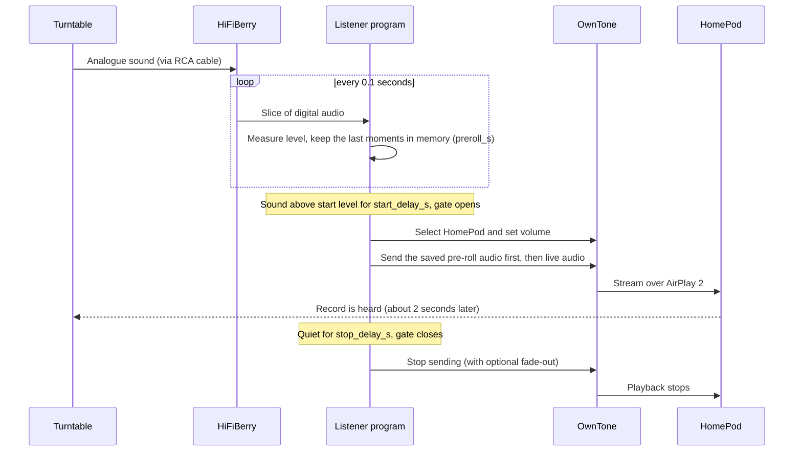
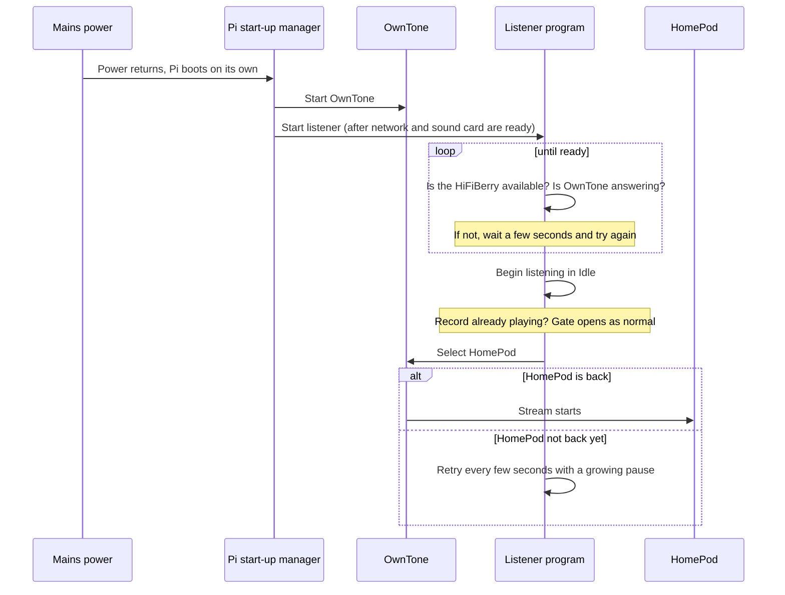
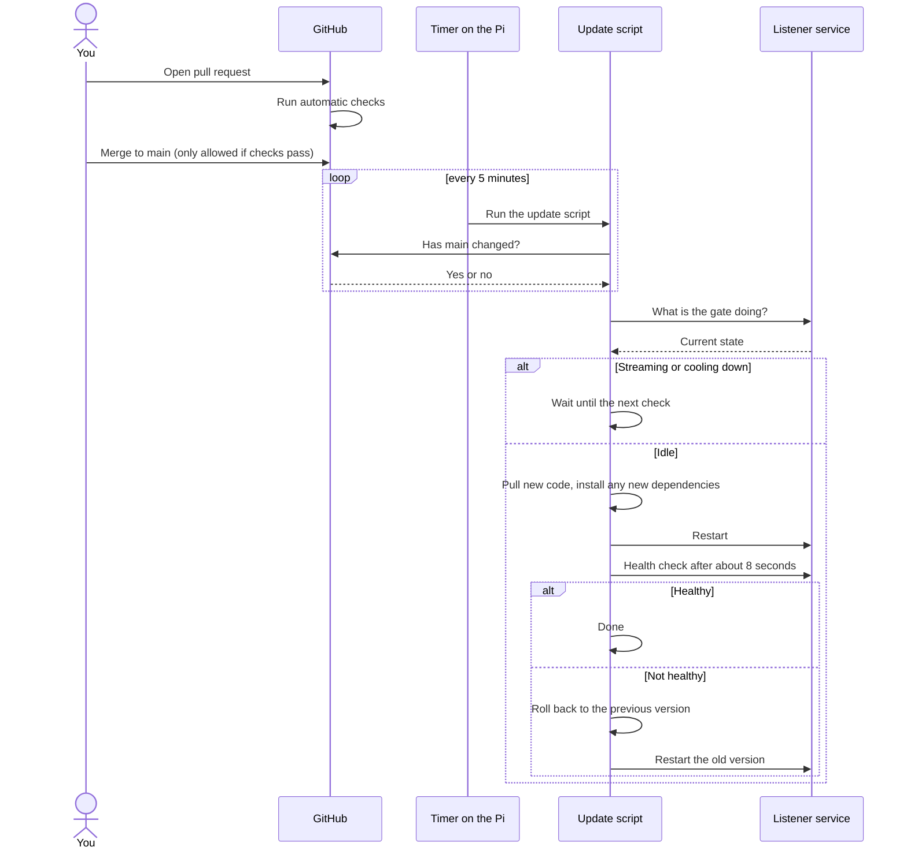

# Vinyl to HomePod: Technical Design

Draft, 30 October 2026

## 1. What we're building

A small box that listens to the record player. When music (or just the crackle of a needle in a groove) is detected, it automatically plays it through the HomePod. When the record player is off, or the record has finished, it stops. Nothing is pressed, tapped or switched.

**Goals**

- Hands-free: needle down means sound, needle up (eventually) means silence.
- Never plays when the record player is switched off.
- Keeps the crackle. The sound is passed along untouched, with no clean-up or filtering.
- Runs unattended on a Pi with no screen, and updates itself when new code is merged on GitHub.

**Not goals**

- Track names, album art or controlling playback from a phone.
- Playing to several speakers at once (possible later).

## 2. What we have

| Item | Role |
|---|---|
| Crosley C100 turntable | The source. It has a built-in amplifier stage and a switch on the back to choose its output type |
| HiFiBerry DAC+ ADC | The "ears": turns the turntable's sound into digital audio the Pi can read |
| Raspberry Pi Zero 2 W | The brain. Runs everything |
| HomePod (original) | The speaker. Receives sound over the home network using AirPlay 2 |
| RCA cable | Connects turntable to HiFiBerry. Check which socket type the HiFiBerry has and buy the matching cable |

**Before starting, check two things:**

1. The Pi Zero 2 W needs a row of pins (a "header") for the HiFiBerry to plug into. **Confirmed: yours has one fitted, so no soldering is needed.**
2. Set the switch on the back of the turntable to **LINE** (not PHONO). This sends a ready-to-use signal. PHONO would be far too quiet.

## 3. How it fits together

```
Turntable → cable → HiFiBerry → Listener program → hand-off point → OwnTone → HomePod
```

1. **HiFiBerry** continuously turns the turntable's sound into digital audio.
2. **Listener program** (we write this, in Python) keeps checking whether the sound looks like a record playing. It is the "gate": open means pass the sound on, closed means don't.
3. **Hand-off point** is a special file on the Pi (a "named pipe"). The listener drops sound into one end, and OwnTone picks it up from the other.
4. **OwnTone** is existing, free software that knows how to talk to AirPlay speakers. We don't write any AirPlay code ourselves.
5. **HomePod** plays what it receives. Expect about two seconds of delay, which is normal for AirPlay and is accepted. What matters is that no audio is lost.

A ready-made project called *autostream* by Lo-tech already does a similar job using OwnTone. It's built around USB sound adapters rather than the HiFiBerry, so treat it as a reference and a fallback, not the plan.

### What happens during a listening session



## 4. The listener program (the part we write)

### What it does, in order

1. Opens the HiFiBerry and reads sound in small slices (about a tenth of a second each).
2. Works out how "loud and crackly" each slice is.
3. Decides whether the gate should be open or closed (rules below).
4. When open, passes the sound to OwnTone and makes sure OwnTone is aimed at the HomePod.
5. Reports its state on a small status page, so we can see what it's thinking.

### The gate: when to start and stop

The gate has four states:

| State | Meaning |
|---|---|
| **Idle** | Nothing playing. Waiting |
| **Arming** | Sound spotted. Making sure it's not a one-off bump |
| **Streaming** | Record is playing. Sound goes to the HomePod |
| **Cooling down** | It's gone quiet. Waiting to see if it comes back |

The rules (all adjustable in a settings file):

| Setting | Starting value | Why |
|---|---|---|
| Start level | a little above the quiet "off" level | Ignores electrical hum and hiss |
| Stop level | a little below the start level | Stops it flickering on and off |
| Start delay (`start_delay_s`) | 1 second to begin with, then tune | Ignores bumps and clicks while handling the player. Shorter means quicker response but more false starts |
| Stop delay (`stop_delay_s`) | 20 to 30 seconds of quiet | Survives gaps between tracks and quiet passages |
| Pre-roll (`preroll_s`) | 1.5 seconds, never less than the start delay plus 0.5 | Audio kept in memory and sent first when the gate opens, so nothing is lost (see "Delay is fine, losing audio is not") |
| Fade-out (`fade_out_s`) | 0 (off) | Nice to have, see below |

### Keeping the crackle

- **Measuring is separate from playing.** The gate may measure a filtered copy of the sound (focusing on the high, scratchy frequencies, which is where crackle lives and electrical hum does not). The sound sent to the HomePod is always the original, untouched.
- **No effects anywhere:** no noise reduction, no volume levelling, no compression.
- **Pre-roll:** the program always keeps the last moments of sound in memory (the length is a setting). When the gate opens, that audio goes first, so the needle landing is not lost.
- **Gentle ending (nice to have):** an optional fade-out when the gate closes, off by default. A fade-in is not planned.
- **Clean capture:** read from the HiFiBerry directly (not through Linux's "default" sound path, which can quietly change the format). Use 44.1 kHz, the same rate AirPlay uses. Leave some volume headroom so loud pops on worn records don't clip.

### Delay is fine, losing audio is not

Priority: the HomePod may play a couple of seconds behind the record, but **every moment of audio must reach it**, from the needle landing to the last note. AirPlay's own delay (normally about two seconds) is accepted and we won't try to reduce it.

There are three sources of delay:

| Delay | Cause | Decision |
|---|---|---|
| Detection | The gate waits `start_delay_s` before opening | Configurable. Shorter is quicker to respond but risks false starts |
| Replay | Pre-roll sends the audio from just before the gate opened, so the stream starts that far behind live | **Kept on.** This is what stops the start of the record being lost |
| AirPlay | The HomePod buffers audio before playing | Accepted as is |

Rules that protect the audio:

- **Pre-roll always covers the detection delay.** `preroll_s` must be at least `start_delay_s` plus about half a second. The program refuses to start if the settings break this rule. The starting values are `start_delay_s: 1` and `preroll_s: 1.5`.
- **No gaps once streaming.** Audio is passed on in order, and if OwnTone is briefly slow to take it, the listener holds it in a short queue rather than dropping it. A counter on the status page shows any audio that couldn't be delivered, which should always read zero.
- **The ending is played in full.** When the gate closes, the listener lets everything already sent finish playing before stopping, so the delayed stream isn't cut off early. Build step 3 will confirm OwnTone behaves this way when the pipe goes quiet.
- **Catch-up is not used.** We never speed up or skip ahead to shrink the delay, because that would alter or lose audio.

You can still tune `start_delay_s` (and so `preroll_s`) by ear: lower it while watching for false starts with the turntable off, platter spinning with the needle up, and while handling the player.

### Calibration (so we don't guess the levels)

A command, `needle-drop calibrate`, guides you through four 10-second recordings:

1. Turntable switched off
2. Turntable on, platter spinning, needle up
3. Needle in the very first groove of a clean record, before the music
4. A quiet passage of music

It prints the levels and suggests start and stop values. The test that matters most is number 3: if the gate opens for that, it will open for everything. The chosen values are saved on the Pi (see section 6).

If you hear a constant hum, a **ground-loop isolator** (an inline RCA adapter, about £10) usually fixes it. Buy a reasonable one, since very cheap ones can dull the treble. Only add it if you hear a problem.

### The status page

A tiny page at `http://<pi-address>:8099/status` returns the current state, the current sound level, the chosen thresholds and an "undelivered audio" counter (which should always be zero). It reports healthy only if the HiFiBerry is open and OwnTone responds. The update process (section 6) relies on this.

## 5. OwnTone setup

- Install OwnTone and let it find the HomePod on the network.
- Create the hand-off point as a named pipe in OwnTone's music folder (for example `/srv/music/vinyl.pipe`), and switch on OwnTone's "pipe autostart" option so it starts playing when sound arrives.
- Sound format on the pipe: raw, 44.1 kHz, 16-bit, stereo.
- The listener tells OwnTone which speaker to use and sets the starting volume, through OwnTone's built-in web interface (API).
- If the HomePod won't pair, check the HomePod's access setting in the Apple Home app.

### Volume

Volume is controlled on the HomePod itself, so nothing extra needs building:

- The **touch panel on top** of the HomePod has + and - controls (it is a touch surface, not physical buttons). Siri ("turn it down") and the Home app slider also work.
- By default the listener **does not touch the volume**. An optional `start_volume` setting can set a level when streaming begins, and is left empty to keep whatever the HomePod is already using.
- OwnTone also has its own volume control for each speaker. Build step 3 will confirm how it interacts with the HomePod's volume, and whether the two stay in sync.

## 6. Code, settings and automatic updates

### Starting by itself after a power cut

After a power interruption nobody should need to log in or press anything. A Pi switches itself on whenever power returns, so the job is to make sure every part then starts on its own, in the right order.

- **Everything is set to start at boot.** The listener, OwnTone and the update timer are all "enabled" in systemd, the Pi's built-in start-up manager (`systemctl enable`). This is part of the one-time setup, not something done by hand after each reboot.
- **Right order.** The listener is told to start after the network, the sound card and OwnTone are ready.
- **Patient, not fragile.** If something isn't ready yet, the listener waits and retries instead of giving up. That covers the HiFiBerry still waking up, OwnTone still loading, and the HomePod taking longer than the Pi to come back (or being unplugged too).
- **Restarts if it crashes.** systemd restarts the listener a few seconds after any failure.
- **Starts in Idle, whatever the turntable is doing.** If power returns while a record is already playing, the gate simply opens as it normally would. Nothing needs to be "reset" first.
- **Settings survive.** Your calibrated levels are stored on the Pi's card (`/etc/needle-drop/config.yaml`), so a power cut doesn't lose them.
- **Card protection.** Sudden power loss is the most common cause of a corrupted SD card, which is why the optional read-only mode in build step 7 is worth doing.



### Repository layout

```
needle-drop/
├── src/needledrop/        the listener program
├── tests/                automatic checks
├── config/default.yaml   standard settings (in Git)
├── requirements.txt
├── deploy/               update script and service files
└── .github/workflows/    checks that run on GitHub
```

### Settings: two layers

- `config/default.yaml` is in Git and holds sensible defaults.
- `/etc/needle-drop/config.yaml` lives **only on the Pi**. It holds your calibrated levels and the HomePod's name, and overrides the defaults. Updates never touch it.
- If a new version adds a setting, the program must fall back to the default when your local file doesn't have it.

### How updates happen

The Pi checks GitHub itself. Nothing is pushed to it, and nothing on your home network is exposed to the internet.



In words:

1. **On GitHub:** every change goes through a pull request. Automatic checks (code style and tests) must pass before it can be merged into `main`.
2. **On the Pi:** a timer runs the update script every 5 minutes.
3. The script asks Git whether `main` has changed. If not, it does nothing.
4. If it has, the script asks the status page what the gate is doing. If a record is playing (Streaming or Cooling down), it **waits** until next time.
5. Otherwise it pulls the new code, installs any new dependencies, restarts the listener, and waits about 8 seconds.
6. It checks the status page. If healthy, done. If not, it **rolls back** to the previous version automatically and restarts that.

**Pi-side setup, once:**

- A dedicated low-privilege user (`needledrop`) that may restart only this one service.
- **No deploy key needed.** The repository is public, so the Pi clones it over plain HTTPS and can only read it. (Never put passwords or secrets in a public repo. Your calibrated settings stay on the Pi, not in Git.)
- Two services (the listener, and the update check) and one timer, installed with systemd.
- Logs for any run: `journalctl -u needle-drop-deploy -n 50`.

## 7. Build order

Each step has a pass/fail check, so problems show up early.

| Step | Work | Done when |
|---|---|---|
| 1. Hardware | Fit HiFiBerry onto the Pi's header, install Raspberry Pi OS Lite, set up Wi-Fi and remote login, switch turntable to LINE | `arecord -l` lists the HiFiBerry |
| 2. Capture | Record a short clip from a playing record | The clip sounds right, with no hum or clipping. Adjust input volume if needed |
| 3. AirPlay | Install OwnTone, pair with HomePod, stream a test file, then pipe in a recording by hand, including one that ends abruptly | Vinyl audio is heard on the HomePod, and the last notes of a clip are played in full. **This is the biggest risk, so do it before writing any real code** |
| 4. Listener | Write the gate, pre-roll, fade-out, status page, calibrate command | All gate behaviours work in tests, then live |
| 5. Run as a service | Install the listener under systemd, and enable it, OwnTone and the update timer to start at boot (see "Starting by itself after a power cut") | Pulling the power and plugging it back in brings everything back with no help |
| 6. Auto-update | Repository, checks, update script, timer, rollback | A merged change appears on the Pi without you touching it. A deliberately broken change rolls back |
| 7. Tidy | Optional: make the SD card read-only to survive power cuts, switch on automatic security updates | Pulling the plug causes no damage |

## 8. How we'll know it works

1. **Turntable off** for an hour or more: never starts.
2. **Platter spinning, needle up:** never starts.
3. **Needle in the first groove of a clean record:** starts, and crackle is audible on the HomePod.
4. **Needle drop:** the thump of landing is heard, every time, across at least 20 needle drops on different records.
5. **Track gaps and a quiet classical record:** no drop-outs.
6. **Needle lifted at the end of a side:** stops within about 30 seconds, and the final notes are played in full rather than cut off.
7. **No audio lost:** the status page's "undelivered audio" counter stays at zero, and a recording of what OwnTone receives matches the HiFiBerry capture from the first thump to the last note.
8. **Untouched sound:** recording the sound going into the pipe and the sound captured from the HiFiBerry, side by side, gives identical results.
9. **Crackly record:** no harsh clipping.
10. **Power cut:** unplug the Pi, plug it back in, and within a couple of minutes it is listening again with no help. Repeat with the turntable already playing, and with the HomePod unplugged at the same time.
11. **HomePod unplugged, then plugged back in:** the system recovers.
12. **Update:** a good change deploys while idle, a broken change rolls back, and nothing interrupts a record that's playing.

## 9. Risks and what we'll do

| Risk | Plan |
|---|---|
| HomePod pairing or AirPlay 2 quirks | Prove it in step 3 before building anything else. Fallback: try autostream |
| Hum or noise triggers the gate | Use the high-frequency measurement, calibrate, add an isolator if needed |
| Quiet music closes the gate | Long stop delay, adjustable |
| Start or end of a record lost | Pre-roll always longer than the start delay, short queue instead of dropping audio, ending played out in full, undelivered-audio counter and recording test |
| Pi Zero 2 W too slow or short on memory | Measure in step 3. Fallback: a bigger Pi |
| A bad update breaks audio | Health check plus automatic rollback, and updates only while idle |
| SD card damaged by power cut | Optional read-only mode (step 7) |
| Pi starts before the HiFiBerry, OwnTone or HomePod are ready | Start in the right order, and retry patiently instead of giving up |

## 10. Decisions and remaining questions

**Decided**

- The Pi has its header fitted, so no soldering is needed.
- The GitHub repository is public, so no deploy key is needed.
- AirPlay's delay is accepted. The priority is that **no audio is lost**, so pre-roll stays on and always covers the start delay. Fade-out is a nice-to-have, off by default, and `start_delay_s` is configurable to tune by ear.
- Volume is controlled on the HomePod (touch controls, Siri, Home app).

**Still to check on the day**

- Which socket type the HiFiBerry has for input (RCA or 3.5 mm), so the right cable is ordered.
- That OwnTone plays out everything already sent when the pipe goes quiet, so the end of a side isn't cut off (build step 3).
- How OwnTone's volume setting interacts with the HomePod's own volume (build step 3).
- Whether a control page for manual on/off is wanted later.
